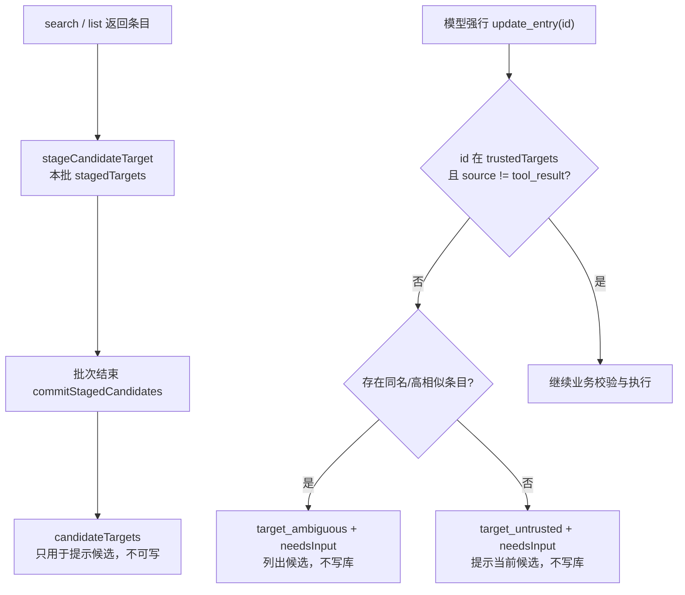
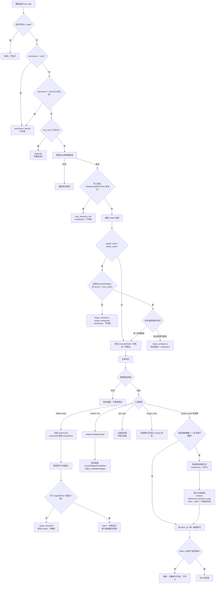

# MEMORA V0.9 — Phase 4.1.3 实施报告（含最终安全验收补强）

> 实施日期：2026-11-16\
> 主题：Agent 执行权限、目标 ID 来源守卫与最终安全验收补强\
> 最终结论：**PASS**\
> 说明：本报告只陈述实际执行过的命令与结果。真实模型验收与桌面端人工点击验收未执行，已在“剩余风险”中明确标注。

---

## 1. 实施结论

### 1.1 总体结论

Phase 4.1.3 已完成，并通过最终安全验收补强。核心不变量是：

- 模型请求里的 `tools` 数组只影响“模型能看到什么”，不构成执行授权；
- 执行器按 `none / read / write` 强制校验工具权限；
- 查询结果（`search_notes` / `list_todos` / `list_reminders`）**只能作为候选**，永远不能直接升级为写授权；
- `update_entry` / `delete_entry` 的目标 ID 必须来自本请求内可验证的用户授权；
- 同名或高相似标题在执行层直接拦截，除非用户已明确指定；
- 失败重试不会自动重复 create / update；
- 删除仍然只生成 ActionCard，且卡片目标必须与提议绑定的 `entryId/kind` 一致；
- 多闹钟候选的一次性授权语义未被削弱。

最终验收阶段发现并修复了一个真实缺口：早期实现会把同批查询命中的条目提交进 `trustedTargets`（`source: 'tool_result'`），守卫只检查“是否在集合中”，因此查询结果可能被当成写授权。本轮已将查询结果隔离到 `candidateTargets`，并在守卫中显式拒绝 `tool_result`。

### 1.2 P0 完成情况

| 编号 | P0 要求 | 状态 | 证据 |
|---|---|---|---|
| P0-1 | 执行层工具权限边界 | 完成 | `createAgentToolScope` 默认 `none`；`isToolAllowed` 在参数校验和业务执行前拦截；降级时收回 `write` |
| P0-2 | 目标 ID 来源校验 | 完成 | `trustedTargets` + `seedTrustedTargets` + `guardWriteTarget`；`<notes>`、历史、`get_note` 不登记 |
| P0-3 | 同名 / 高相似目标歧义拦截 | 完成 | `findAmbiguousTargets` + `titlesAreSimilar`；返回候选并设置 `needsInput`，不写入 |
| P0-4 | retry / 重复写保护 | 完成 | `agentRetryLedger` + 请求内 `writeSignatures` / `executedCalls`；重试禁止再次 create/update |
| P0-5 | 删除 ActionCard 目标绑定 | 完成 | 确认时校验 `proposal.entryId` 与 `targetId`、`proposal.kind` 与 `expectedKind`，不一致返回 `target_mismatch` |
| P0-6 | 多闹钟候选授权不被绕过 | 完成 | 模型指定已触发 `alarm_id` 时拒绝；授权路径只接受卡片记录的 entry/alarm/字段白名单 |
| P0-7 | 自动化测试与回归验证 | 完成 | 单元测试 218 pass；Mock SSE 集成测试 31 pass；lint、build、`cargo check`、`pnpm tauri:build` 通过 |
| P0-8 | 最终实施报告 | 完成 | 本文件 |

### 1.3 最终安全验收补强项

| 编号 | 要求 | 状态 | 证据 |
|---|---|---|---|
| A-1 | 查询结果不得被提升为用户写授权 | 完成 | `candidateTargets` 与 `trustedTargets` 分离；守卫拒绝 `tool_result`；专项测试与集成场景 |
| A-2 | 唯一标题不得造成误授权 | 完成 | 从句级动作判定、目的标题剔除、创建从句排除、唯一命中要求 |
| A-3 | 中文自然语言目标选择安全 | 完成 | 中文语句矩阵 16 组，单元测试与真实 store 集成测试覆盖 |
| A-4 | 新增安全回归测试 | 完成 | `tests/agentPermissionTargets.test.ts` 36 个测试；集成场景 9 个 |
| A-5 | 尝试 Tauri 构建验证 | 完成 | `pnpm tauri:build` 成功，产物见第 12 节 |
| A-6 | 更新实施报告并给出明确结论 | 完成 | 本文件，结论 PASS |

### 1.4 未验证事项

- 未使用真实模型 API 执行验收；所有模型行为均由本地 Mock SSE 驱动。
- 未进行 Tauri 桌面端人工点击验收；构建成功只证明可编译、可打包，不证明交互流程。
- 未在 macOS / Linux 上运行；本报告结果来自当前 Windows 工作区。
- `pnpm test:integration` 运行期间出现过一次 Vite HMR WebSocket 端口占用日志（`Port 24678 is already in use`），全部 31 个用例仍通过；该日志属于开发服务器环境噪声，不是业务断言失败。

---

## 2. 修改范围与边界

### 2.1 新增文件

| 文件 | 原因 | 主要改动 | 业务影响 |
|---|---|---|---|
| `src/services/agentTargets.ts` | 目标来源、标题相似度、中文从句解析是纯逻辑，需要独立可测 | `TargetTrustSource`、`compactTitle`、`titlesAreSimilar`、`findAmbiguousTargets`、`extractExplicitEntryIds`、`resolveExplicitIdTargets`、`resolveExplicitTitleTargets`、`hasSelectedReferentWriteIntent`、`sourceBypassesAmbiguity` | 执行层可以确定“ID 来自哪里”“标题是否歧义”“句子是否真的在要求写入” |
| `src/services/agentRetryLedger.ts` | 失败重试需要识别上一轮是否已有写入尝试 | `buildRetryLedger`、`mergeRetryLedger`、`retryBlockedWriteTools`、`retryWriteSignatures`、`retrySystemNote` | 同一失败请求重试时禁止自动重复 create/update |
| `tests/agentPermissionTargets.test.ts` | 权限、来源、歧义、重试、删除绑定的专项回归 | 36 个安全专项测试，覆盖查询候选与中文语句矩阵 | 将关键安全不变量固化为自动化断言 |

### 2.2 修改文件

| 文件 | 原因 | 主要改动 | 业务影响 |
|---|---|---|---|
| `src/services/agentToolExecutor.ts` | 执行边界必须由执行器强制 | 新增 `ToolPermission`、`TrustedTarget`、`WriteAttempt`；默认 `permission: 'none'`；新增 `isToolAllowed`、`candidateTargets`、`stageCandidateTarget`、`commitStagedCandidates`、`seedTrustedTargets`、`guardWriteTarget`；查询结果不再进入 `trustedTargets`；守卫显式拒绝 `source === 'tool_result'` | 伪造/复用 ID、查询结果冒充授权、同名目标、重试重复写都会在写库前被拦截 |
| `src/store/useAssistantStore.ts` | 请求级作用域、候选提交与重试账本接入真实 Agent loop | 先分析 intent/plan 再创建 scope；按 `toolPlan.mode` 设置权限；接入 `seedTrustedTargets`、`commitStagedCandidates`、retry ledger；选中条目授权要求本轮从句同时包含写动作与明确指代；降级时把 scope 权限收为 `none` | 生产请求获得真实权限、来源与重试保护；“新建/普通修改直接执行、删除确认”的既有语义不变 |
| `src/services/agentExecution.ts` | 拦截结果需要进入执行记录和终态 | `stepStatusLabel` 对 `blockedCode` 显示“已拦截”；step 复制 `blockedCode`；`ExecutionSummary` 增加 `blocked` | 用户能看到哪些调用被拦截 |
| `src/types/ai.ts` | 执行记录需要携带拦截原因 | `AssistantToolStep` 增加 `blockedCode?: string` | 拦截原因可持久化到消息记录 |
| `src/services/agentToolSchema.ts` | 让模型理解执行层规则，但不把提示词当唯一防线 | 更新 `update_entry.id`、`get_note`、`delete_entry` 描述；新增 Rule 20 | 减少模型提出不可执行调用；执行层仍独立拦截 |
| `src/services/assistantIntent.ts` | 权限计划与执行 scope 需要保持语义一致 | 补充注释：工具范围同时作为执行层权限声明传入 scope | 避免把 `tools` 数组误当授权 |
| `src/services/deleteExecution.ts` | 删除卡片可能被篡改 `targetId/kind` | 增加 `target_mismatch`；claim 后校验提议与卡片目标一致 | 不能借另一个 targetId 或类型删除未确认对象 |
| `src/services/reminderAlarms.ts` | 模型可能指定已触发闹钟绕过待触发候选 | `applyReminderTime` 要求 `alarm_id` 属于当前候选 | 保持“候选一次性授权”不被绕过 |
| `tests/helpers.ts` | 测试需要显式构造 scope 和信任来源 | 增加 scope 选项；`trust(entry, source = 'user_explicit')`；`addEntry` 成功后登记 `created` | 夹具可模拟“已授权”和“未授权”两种环境 |
| `tests/agentTools.test.ts`、`tests/agentExecution.test.ts`、`tests/alarmSelection.test.ts`、`tests/prompts.test.ts`、`tests/reminderAlarms.test.ts`、`tests/deleteExecution.test.ts` | 适配执行层权限与新增守卫 | 显式 scope 权限、信任 seeded ID、候选提交、提示词断言、闹钟与删除绑定测试 | 原有测试意图保留，断言未被放宽 |
| `scripts/integration/mockSseServer.mjs`、`harness.mjs`、`run-integration-tests.mjs` | Mock SSE 需要覆盖失败重试与真实 store 路径 | 支持错误响应、`streamErrorAfter`、`retryPrompt()`、`selectEntry()`；新增 9 个安全场景 | 覆盖权限、来源、中文语句、选中条目与 retry 的生产路径 |

### 2.3 明确未修改

- 未修改 Rust SSE 代理（`src-tauri/src/ai.rs` 未变更）。
- 未修改 SQLite 结构或迁移版本。
- 未新增第三方依赖、Agent 框架或 MCP。
- 未修改 OpenAI Tool Calling 通信协议。
- 未修改主题、品牌、V0.8 视觉、Tauri 窗口配置。
- 未删除现有测试，未放宽断言；原有测试仅按新的权限/批次语义调整。
- 未执行 Git commit / push / reset / clean / checkout。

---

## 3. 查询结果与用户授权的区分

### 3.1 四个必须分开的层级

| 层级 | 含义 | 是否可写 | 本实现中的位置 |
|---|---|---|---|
| 1. 查询结果存在 | `search/list` 返回了某条目 | 否 | `stagedTargets` → `candidateTargets` |
| 2. 查询结果与请求相关 | 模型认为该结果符合用户意图 | 否 | 仍是 `candidateTargets`，只用于提示和候选列表 |
| 3. 用户明确指定某个结果 | 原文写出唯一标题或显式 ID，且处于写动作从句 | 是 | `trustedTargets`，`source: user_explicit` |
| 4. 用户明确选择某个结果 | 用户在候选/列表中选择，且本轮明确指代并发出写动作 | 是 | `trustedTargets`，`source: user_selected` |

关键点：第 1、2 层永远不能自动变成第 3、4 层。模型选中一个 ID、结果与请求高度相关、结果唯一，都不构成用户授权。

### 3.2 数据结构

`AgentToolScope` 中三类目标严格分离：

```ts
trustedTargets: Map<string, TrustedTarget>    // 用户授权，可用于 update/delete
candidateTargets: Map<string, TrustedTarget>  // 查询候选，仅用于提示，不可写
stagedTargets: TrustedTarget[]                // 本批查询命中，批次结束后转入候选
```

- `stageCandidateTarget`：查询工具每命中一条，先放入本批 `stagedTargets`；
- `commitStagedCandidates`：批次结束后转入 `candidateTargets`；
- 两者都不会写入 `trustedTargets`；
- `guardWriteTarget` 只承认 `trustedTargets` 中且 `source !== 'tool_result'` 的目标。

### 3.3 查询到写入的完整边界



### 3.4 用户选中候选后的授权

- 列表选中只提供 `selectedId`；
- 只有本轮意图为 `referent_resolved`，**并且**用户原文某个从句同时包含写动作与“这个/当前/选中/这条/这篇/本条/该便签/该条目”等明确指代时，才登记 `user_selected`；
- 执行前重新读取当前条目；目标已被删除或替换时，旧选择不再可用；
- “这条笔记有哪些修改”“选中条目里写了什么”这类查询句不会授权写入。

---

## 4. `tool_result` 是否能直接授权写入

**不能。** 本轮最终验收发现并修复了早期实现的真实缺口：

- 早期行为：`search/list` 结果在批次结束后进入 `trustedTargets`，来源标记为 `tool_result`；`guardWriteTarget` 只判断 ID 是否在集合中，导致下一轮模型可直接修改/删除查询命中的条目。
- 修复后行为：
  1. 查询结果只进入 `stagedTargets` / `candidateTargets`；
  2. `guardWriteTarget` 显式要求 `trusted.source !== 'tool_result'`，即使未来有代码误把查询结果放进 `trustedTargets`，也不会被当作授权；
  3. 未授权目标返回 `target_untrusted`，并在消息中附带当前候选，设置 `needsInput`，不写库；
  4. 若未授权目标还存在同名/高相似条目，优先返回 `target_ambiguous`，列出候选。

因此 `tool_result` 在当前实现中只是“来源标记”和候选提示依据，不是授权来源，也不会因为“同批/下一批”而升级。

---

## 5. 唯一标题造成错误授权的风险与处理

### 5.1 风险来源

1. 标题包含关系导致误匹配（如“项目总结”命中“项目总结2024”）；
2. “把 A 改成 B”把新标题 B 误当操作目标；
3. “新建一条叫项目总结的笔记”把已存在的同名条目误当修改目标；
4. “有哪些修改”“修改建议”把名词用法当成写动作；
5. 一句话提到多个标题时默认选择第一条；
6. 纯查询句中出现标题或 ID 就被当作授权。

### 5.2 当前处理

- **从句切分**：按标点、换行、“然后/接着/之后/同时/顺便”等切分，逐从句判断；
- **动作必须在谓语位置**：从句开头动作、动作+后缀（一下/为/成/掉/到…），或“把/将……动作”结构；
- **目的标题剔除**：`改成/改为/重命名为/标题设为…` 之后的内容不参与目标匹配；
- **创建从句排除**：`创建/新建/新增/添加/记一下…` 且没有明确“把/将”结构时，其中的标题只视为新建内容；
- **最长标题优先**：同一从句命中多个标题时只保留最长者，减少短标题误命中；
- **唯一命中才授权**：`resolveExplicitTitleTargets` 返回多个条目时，全部降级为候选，不做默认选择；
- **执行层歧义复查**：即使标题唯一解析成功，只要执行时存在同名/高相似条目，仍会 `target_ambiguous`；
- **保守拦截**：无法判断是否唯一时拒绝写入并要求用户确认，而不是猜测。

---

## 6. 中文语句测试矩阵

下表全部有对应单元测试；标注“集成”的另有真实 store + Mock SSE 场景。

| # | 用户语句 | 期望行为 | 实际机制 | 测试 |
|---|---|---|---|---|
| 1 | 帮我新建一条叫「项目总结」的笔记 | 只创建；不修改已有「项目总结」 | 创建从句排除 + 无写动作 | 单元 + 集成 |
| 2 | 把「项目总结」改成「新版总结」 | 唯一时修改「项目总结」；「新版总结」不是目标 | 目的标题剔除 + 唯一命中 | 单元 + 集成 |
| 3 | 删除「项目总结」 | 唯一时只生成删除确认卡片 | 标题授权 + ActionCard | 单元 + 集成 |
| 4 | 帮我找一下「项目总结」 | 只读查询，不写 | 无写动作 | 单元 |
| 5 | 「项目总结」有什么内容 | 只读查询，不写 | 无写动作 | 单元 |
| 6 | 帮我想一个「项目总结」的标题 | 建议，不创建/不修改 | 无写动作 | 单元 |
| 7 | 把刚才那个改一下 | 无法确定目标时询问 | 无具体标题/ID；指代词不匹配授权集合 | 单元 + 集成 |
| 8 | 修改「工作笔记」（存在多条） | `target_ambiguous` + `needsInput` | 多候选不默认选择 | 单元 |
| 9 | 把 A 改成 B | 只授权 A；B 是目的内容 | 目的标题剔除 | 单元 + 集成 |
| 10 | 创建笔记 A，然后修改笔记 B | 只授权 B；A 仅创建 | 从句切分 + 创建从句排除 | 单元 + 集成 |
| 11 | 搜索「项目总结」后模型强行 update | 拒绝，`target_untrusted` | 查询结果仅候选 | 单元 + 集成 |
| 12 | 查询返回多个候选，模型自选一个 | 拒绝并询问 | 候选不授权 + 歧义守卫 | 单元 + 集成 |
| 13 | 查询唯一结果，但用户没有写指令 | 仅候选，不写 | 相关性不等于授权 | 单元 |
| 14 | 「项目总结里有哪些修改」 | 只读，不写 | 名词用法不算写动作 | 单元 |
| 15 | 「这条笔记有哪些修改」（已选中） | 不授权写入 | 选中授权要求写动作 + 明确指代 | 单元 + 集成 |
| 16 | 查询语句里出现显式 ID | 不授权写入 | 显式 ID 必须与写动作同从句 | 单元 |
| 17 | 一次提到多个可修改标题 | 不默认选择，进入询问 | 多命中降级为候选 | 单元 |
| 18 | 历史消息/上下文里的 ID | 不授权写入 | 不进入 `trustedTargets` | 单元 + 集成 |

补充验证：

- 同名目标 update 被拦截并列出所有候选 ID；
- 高相似标题 delete 被拦截，不生成卡片；
- 用户显式指定 ID 时允许执行，不受另一条同名记录影响；
- 本轮新建条目后可在同一请求内继续修改；
- 选中目标在等待期间被删除后，旧选择不能写入；
- 删除唯一明确标题仍只生成确认卡片。

---

## 7. 最终执行链路



### 7.1 关键顺序

`executeToolWithEnv` 的实际顺序：

1. stale 检查；
2. 执行层权限检查；
3. `tool_call_id` 去重；
4. 参数校验；
5. retry 写保护；
6. 读取 entries 快照；
7. update/delete 目标来源与歧义守卫；
8. 登记执行 ID、写签名、写尝试；
9. 业务执行；
10. 结果回读与校验；
11. 查询结果 staging / 创建目标登记。

目标来源与歧义守卫放在写签名登记之前，避免被拦截的调用占用幂等签名，导致用户下一次合法重试被误判为重复。

---

## 8. 权限矩阵

`permission` 是执行层字段，不是模型参数。`createAgentToolScope` 缺省值为 `none`。

| 工具 | none | read | write | 说明 |
|---|---|---|---|---|
| `search_notes` | 拒绝 | 允许 | 允许 | 只读；结果进入 staging → candidate |
| `list_todos` | 拒绝 | 允许 | 允许 | 只读；结果进入 staging → candidate |
| `list_reminders` | 拒绝 | 允许 | 允许 | 只读；结果进入 staging → candidate |
| `get_note` | 拒绝 | 允许 | 允许 | 只读；不登记可写目标 |
| `create_entry` | 拒绝 | 拒绝 | 允许 | 直接执行，成功后登记 `created`；受 retry 保护 |
| `update_entry` | 拒绝 | 拒绝 | 允许 | 需目标来源与歧义守卫；多闹钟可能转为候选卡片；受 retry 保护 |
| `delete_entry` | 拒绝 | 拒绝 | 允许生成卡片 | 永不直接删除；只生成 ActionCard，用户确认后才执行 |
| 未知工具名 | 拒绝 | 拒绝 | 拒绝 | 不在 `AGENT_TOOL_NAMES` 中，不能进入业务分支 |

补充：

- `permission: 'none'` 用于普通聊天、上下文关闭、工具降级后的请求；
- `permission: 'read'` 仍会拒绝 create/update/delete；
- `permission: 'write'` 只表示“允许尝试”，不等于调用必然成功；
- 降级路径会把现有 scope 的 `permission` 改为 `none`。

---

## 9. ID 来源信任矩阵

### 9.1 可信来源

| 来源 | 建立条件 | 可授权的操作 | 失效范围 |
|---|---|---|---|
| `user_explicit`（显式 ID） | 用户原文某个写动作从句中包含 UUID，或 `id: xxx` / `id=xxx` 且 ID 长度至少 8 | update / delete 对应条目 | 仅当前请求 scope |
| `user_explicit`（唯一标题） | 原文有明确写动作，剔除目的标题后，标题唯一命中 | update / delete 对应条目 | 仅当前请求 scope；多命中不建立 |
| `user_selected` | 有条目被选中，本轮意图为 `referent_resolved`，且原文从句同时包含写动作与明确指代 | update / delete 选中条目 | 仅当前请求 scope；执行前复查目标仍存在 |
| `created` | 本轮 create 成功且回读确认存在、类型一致 | 后续 update 本轮创建的条目 | 仅当前请求 scope |
| `authorized_selection` | 用户点击多闹钟候选卡片 | 只修改该 entry 的指定 alarm，且只允许卡片记录的字段 | 单次授权；proposal 状态、过期、页面切换后失效 |

### 9.2 不可信来源

| 来源 | 处理 |
|---|---|
| `search_notes` / `list_todos` / `list_reminders` 结果 | 只进入 staging → `candidateTargets`；永不写入 `trustedTargets` |
| 任何 `trustedTargets` 中的 `source: 'tool_result'` | 守卫显式拒绝，返回 `target_untrusted` |
| `<notes>` 上下文 / 历史消息中的 ID | 不登记；update/delete 被 `target_untrusted` 拦截 |
| 模型自行拼接、猜测、复用的 ID | 不登记；即使条目真实存在也拒绝 |
| `get_note` 读取结果 | 只返回内容；不登记为可写目标 |
| 标题模糊匹配 / 编辑距离相似 | 只作为歧义拦截信号，不直接执行 |
| 旧消息中的删除卡片 | 提议在内存中；重启、过期、取消、已执行后不可用 |
| 模型传入的 `alarm_id` | 不是用户授权；多候选时必须由用户点击卡片 |
| 用户手动编辑后的旧快照 | 授权执行前复查 entry/alarm/patch 字段；不一致则失效 |

### 9.3 授权生命周期

1. 用户发出新消息时，新建请求级 `AgentToolScope`，上一请求的 `trustedTargets`、候选、幂等集合全部丢弃。
2. `seedTrustedTargets` 只登记原文写动作从句中的显式 ID / 唯一标题 / 明确指代的选中条目。
3. 查询结果只在批次结束进入 `candidateTargets`，永远不成为授权。
4. 创建成功后立即登记 `created`，允许同一请求的后续轮次修改刚创建的条目。
5. 用户点击闹钟候选时，使用独立 scope（`authorized_selection`）。
6. 删除提议由用户点击 ActionCard 时 claim 一次；卡片目标必须与提议绑定目标一致。
7. 用户发送新消息、点击停止、清空会话、请求失败重试边界都会清理或丢弃相应内存授权。

---

## 10. Retry 处理机制

### 10.1 同一用户操作的识别

- `retry()` 取最后一条 user 消息内容；
- 只有内存中的 `retryLedger.userContent` 与它完全相同，才把账本交给下一次 `send()`；
- 普通新消息不会继承账本：`send()` 在非 retry 交接时清空 `retryLedger`；
- 这是“用户点击重试”的显式路径，不是对网络错误做无限自动重放。

### 10.2 重试时的行为

| 情况 | 处理 |
|---|---|
| 上一轮有 create/update 尝试 | 本次 retry 的 `create_entry` / `update_entry` 直接返回 `retry_duplicate_risk` + `needsInput`，不写库 |
| 上一轮只有查询 | 不阻止写入；按正常权限与来源规则执行 |
| 上一轮生成过删除卡片 | 不自动执行删除；本次仍只能生成新卡片 |
| 上一轮结果不确定 | 与“已尝试”同样处理，宁可少写，不重复写 |
| 重试再次失败 | `mergeRetryLedger` 保留上一轮 writes 与 `blockedCreateUpdate` |
| 重试成功 | 最终回答成功时清空账本 |

### 10.3 请求内去重

- `executedCalls`：同一 `tool_call_id` 不重复执行；
- `writeSignatures`：同参数写调用不重复写入；签名在写入前登记，失败也不允许同参数重放；
- 被权限 / 来源 / retry 守卫拦截的调用不登记签名，避免占掉后续合法重试；
- 删除永远不会因为“重试”而直接落库。

### 10.4 已知限制

- 用户手动重新输入同一句话（不是点击 retry）会被视为新消息，不继承账本。
- 账本只存在内存，应用重启后不会阻止历史重复操作。
- 保守策略可能让用户在重试时无法完成本可安全执行的 create/update，需要用户确认后作为新任务继续。

---

## 11. 测试报告

### 11.1 数量变化

| 套件 | Phase 4.1.3 前 | 当前 | 新增 |
|---|---:|---:|---:|
| 单元测试 `pnpm test:agent` | 179 pass | **218 pass** | +39 |
| Mock SSE 集成 `pnpm test:integration` | 20 pass | **31 pass** | +11 |
| 合计 | 199 pass | **249 pass** | +50 |

最终验收补强单独新增：

- `tests/agentPermissionTargets.test.ts`：19 → **36**，新增 17 个；
- `scripts/run-integration-tests.mjs`：新增 9 个真实 store + Mock SSE 场景；
- 提示词与其他测试只增加断言，不降低原有断言。

### 11.2 新增单元测试覆盖

**查询候选与用户写授权边界（17 个）**

- 只要求搜索时，下一轮模型强行修改查询结果仍被拦截；
- 多个查询候选时模型自选一个被拦截，并 `needsInput`；
- 搜索命中唯一结果但没有写指令时，结果只是候选；
- 用户明确说出唯一标题时才直接授权修改；
- 用户点击候选条目后，可修改该条但不能改其它条；
- 用户选择后目标已不存在时不能凭旧选择写入；
- 新建同名标题不会授权修改已有条目；
- “修改 A 为 B”只把 A 当目标；
- 修改工作笔记遇到同名条目时必须询问；
- 查询句里的“修改”是名词用法，不构成写授权；
- 查询、建议和含糊整理都不产生标题写授权；
- 一次提到多个可修改标题时不做默认选择；
- 创建目标与修改目标分属不同从句时只授权修改目标；
- 历史消息或“刚才那个”不能把 ID 变成授权目标；
- 查询语句里出现显式 ID 也不等于写授权；
- “这条笔记有哪些修改”不是选中条目的写授权；
- 删除唯一明确标题仍只生成确认卡片。

**权限**

- 缺省 scope 为 `none`，create/search 均被 `permission_denied`；
- `read` 允许查询，create/update/delete 均被拒绝且无副作用；
- `write` 允许 create；被权限拦截的调用不占用幂等记录；
- 未知工具被拒绝；
- `onBlocked` 回调收到正确工具与原因。

**目标来源与歧义**

- 仅上下文出现、未登记的 ID 被 `target_untrusted`；
- `get_note` 成功不代表写授权；
- 同批查询结果不能立即写入，下一批也只是候选；
- 选中条目只有在本轮明确指代且存在写动作时才授权；
- 用户原文显式 UUID 和唯一标题可以授权；
- “改成的新标题”恰好是已有条目时，不会被误当作操作目标；
- 本轮刚创建的真实 ID 可继续修改；
- 同名/高相似目标被拦截并列出候选。

**Retry 与删除绑定**

- 账本识别 create/update 成功、失败尝试；
- 多次失败合并账本不丢保护；
- 阻塞 scope 下 create/update 被拦截，查询与删除卡片仍可用；
- 删除卡片 `targetId`/`expectedKind` 与提议不一致时返回 `target_mismatch`，不执行删除。

### 11.3 新增 Mock SSE 集成场景

1. 只读搜索请求后模型强行修改：执行层拒绝且不写库；
2. 写意图但目标不明确：查询候选不能被模型当成写授权；
3. 查询句中的“修改”是名词用法：模型强行写仍被拦截；
4. 创建同名标题只授权新建，不授权修改已有条目；
5. 一次要求修改多条时，模型不能自行选择第一条；
6. 用户在列表中选中候选后，只修改选中条目；
7. 选中条目出现在查询句里也不能成为写授权；
8. 创建 A 与修改 B 分属不同从句：只授权 B；
9. 历史指代“刚才那个”不能绕过目标授权。

所有被拦截场景均断言 Repository 条目数量/内容未变化。

### 11.4 实际命令结果

| 命令 | 结果 |
|---|---|
| `pnpm test:agent` | `# tests 218` / `# suites 32` / `# pass 218` / `# fail 0` |
| `pnpm test:integration` | `# pass 31` / `# fail 0` |
| `pnpm lint` | `Found 0 warnings and 0 errors`（129 files，116 rules） |
| `pnpm build` | `tsc -b` 通过；Vite 构建成功；仅有既有的 >500 kB chunk 提示 |
| `cd src-tauri && cargo check` | `Finished dev profile`，通过 |
| `pnpm tauri info` | 正常输出环境信息，未再出现 Node 版本解析 panic |
| `pnpm tauri:build` | release 构建成功，NSIS 安装包成功生成 |
| `pnpm test:real` | **未运行**：需要真实模型配置/密钥并会产生外部请求，当前未获得执行授权 |

### 11.5 测试可信度说明

- 单元测试使用真实仓储实现 `MemoryEntryRepository`；
- Mock SSE 场景加载真实 `useAssistantStore.ts`、`aiClient.ts`、工具执行器；
- 未删除原有测试，未降低断言；
- 真实模型、真实网络、桌面端点击流程未验证。

---

## 12. Tauri 构建结果

### 12.1 环境

`pnpm tauri info` 实际输出摘要：

- OS：Windows 10.0.26200 x86_64；
- WebView2：157.0.4341.46；
- MSVC：Visual Studio 生成工具 2026；
- rustc / cargo：1.96.0；rustup：1.29.0；toolchain：stable-x86_64-pc-windows-msvc；
- node：22.15.1（Tauri CLI 探测结果）；pnpm：11.20.0；
- tauri：2.12.5；tauri-build：2.7.4；@tauri-apps/api：2.12.4；@tauri-apps/cli：2.12.3。

此前报告中 `pnpm tauri info` 的 Node 版本解析 panic 在当前环境未复现；本次未修改任何全局或项目配置来绕过版本探测。

### 12.2 构建结果

`pnpm tauri:build` 在最终代码上执行成功：

- Rust release 编译完成：`Finished release profile [optimized] target(s) in 2m 20s`；
- 应用：`src-tauri/target/release/bianqian.exe`；
- 安装包：`src-tauri/target/release/bundle/nsis/MEMORA_0.2.0_x64-setup.exe`，5.10 MiB；
- 构建过程中 Vite 仍提示 `DetailPane` 等 chunk 超过 500 kB，这是既有体积提示，不影响构建成功。

说明：构建成功证明前端类型检查、打包与 Rust release 编译、NSIS 打包链路可用；不代表已做桌面端人工点击验收。

---

## 13. 剩余风险与已知限制

1. **中文标题解析是确定性启发式**，不是完整 NLP。动作词、目的标题、创建从句、从句切分和相似度阈值可能产生“过度拦截”或少量误判；安全方向偏保守。
2. **没有独立的笔记候选卡片**。当前“用户选择候选”复用主列表 `selectedId`，并要求本轮明确指代；未选中时模型只能收到 `needsInput`，由用户补充目标。
3. **授权只在内存中**。应用重启后 `trustedTargets`、候选、retry ledger、删除/闹钟提议都会清空；没有跨会话幂等账本。
4. **拦截审计未持久化**。目前通过 `console.warn` 与消息执行记录观察，没有 SQLite 安全审计表。
5. **模型仍可能在自然语言中错误描述结果**。执行层能保证不写库，但不能保证模型措辞绝对准确。
6. **retry 保护只覆盖点击“重试”的同一用户内容**；用户手动改写后重新发送属于新任务。
7. **真实模型与提示注入未验收**。执行层守卫不依赖模型是否遵守提示，但未对多个真实 provider 跑越狱/注入矩阵。
8. **桌面端交互未人工验收**。`pnpm tauri:build` 只证明可编译、可打包。
9. **集成测试环境的 Vite HMR 端口冲突**会在日志中出现 `Port 24678 is already in use`，本次未终止用户进程；不影响 31 个用例结果。
10. **删除确认后的实际仓储操作**仍由现有 UI/仓储路径执行，本次只强化了提议与卡片目标的一致性校验。

后续建议（不属于本阶段实施）：

- 用多个真实 provider 跑一轮工具调用与错误码验收；
- 为拦截事件增加可选持久化审计；
- 补充更多中文句式回归，尤其是多目标并列、长句嵌套和口语指代；
- 在桌面端做一次真实点击验收：普通创建、普通修改、同名删除、多闹钟选择、失败重试、停止请求。

---

## 14. Git 状态

### 14.1 检查方式

仅执行只读命令：

```bash
git status --short
git diff --stat
git diff --cached --stat
```

未执行 `git commit`、`git push`、`git reset`、`git clean`、`git checkout` 或其他写操作。

### 14.2 当前状态摘要

- **修改（未暂存）**：本轮涉及的 `src/services/agentToolExecutor.ts`、`agentTargets.ts`、`agentExecution.ts`、`agentToolSchema.ts`、`deleteExecution.ts`、`reminderAlarms.ts`、`store/useAssistantStore.ts`、`types/ai.ts`、相关测试与集成脚本。
- **修改（已暂存 + 未暂存）**：部分文件同时存在前序阶段已暂存内容和本轮未暂存修改，例如 `agentToolExecutor.ts`、`useAssistantStore.ts`、`tests/*.test.ts`、`scripts/integration/*`。
- **新增未跟踪**：
  - `src/services/agentTargets.ts`
  - `src/services/agentRetryLedger.ts`
  - `tests/agentPermissionTargets.test.ts`
  - `docs/reports/MEMORA-V0.9-PHASE-4.1.3-IMPLEMENTATION-REPORT.md`
- **已暂存但非本轮新增**：工作区中还存在 Phase 1–4.1.2 的既有暂存文件（包括 `package.json`、部分 `scripts/*`、`src/*`、`tests/*`、`docs/*`），本报告不将其归因于本阶段。
- **冲突**：无。
- 工作区不是干净状态；本阶段没有创建提交，也没有整理或覆盖用户已有的暂存内容。

---

## 15. 最终结论

**PASS**

Phase 4.1.3 的执行层安全边界已完成，并通过最终安全验收补强：

- 查询结果只作为候选，不能直接授权写入；
- `tool_result` 即使进入 `trustedTargets` 也会被守卫拒绝；
- 同批查询、`get_note`、历史消息、模糊标题都不构成写授权；
- 唯一明确标题在满足写动作、非目的标题、唯一命中的条件下可直接执行；
- 多候选、同名、高相似目标在执行层被拦截并要求用户明确选择；
- 删除仍由用户点击确认，且卡片目标不可篡改；
- 失败重试不会自动重复创建或修改；
- 多闹钟候选的一次性授权保持完整；
- 单元测试 218 pass、集成测试 31 pass、lint 0/0、build、`cargo check`、`pnpm tauri:build` 全部通过。

PASS 的适用范围是“当前执行层安全机制与 Mock SSE 回归”；真实模型行为、桌面端人工点击流程尚未验收，相关限制已列于第 13 节。

本阶段到此停止，不进入 Phase 4.2，不执行 Git commit / reset / clean 或任何破坏性操作。
